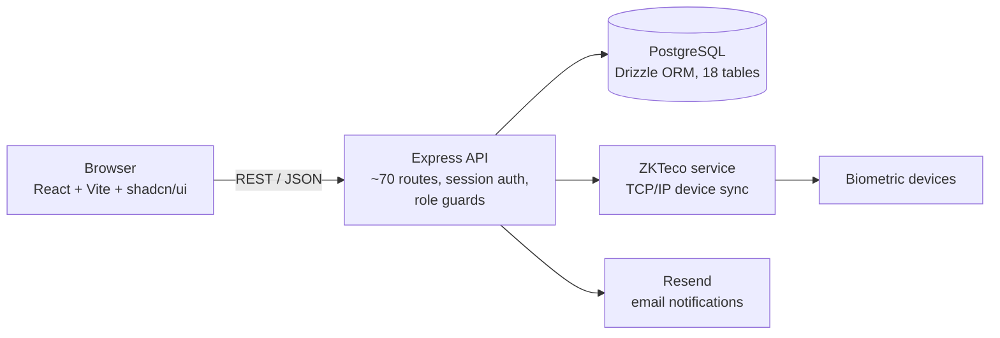

# HRMastermind

**A full-stack HR management system with biometric attendance built in.** HRMastermind covers the employee lifecycle from job posting to payslip, and pulls clock-in and clock-out records straight from ZKTeco attendance devices, so HR stops reconciling spreadsheets against a fingerprint reader.


---

## What it does

| Module | Highlights |
| --- | --- |
| **Dashboard** | Role-specific metrics, pending approvals, recent activity |
| **Employees and departments** | Directory with search and filters, profiles mapped to biometric IDs, organisation structure, employment status |
| **Attendance** | ZKTeco device integration over TCP/IP, device configuration and sync logs, calendar view, manual corrections |
| **Leave** | Configurable leave types and balances, request and multi-level approval flow |
| **Expenses** | Claims with receipt upload, categories, approval queue |
| **Performance** | Goals with progress tracking, appraisals, feedback, review cycles |
| **Payroll** | Salary structures with allowances and deductions, automatic net pay, monthly payroll records (payslip download not yet wired up) |
| **Recruitment** | Job postings and a candidate pipeline: Applied → Screening → Interview → Offer → Hired |
| **Reports** | Attendance, leave, expense and performance summaries with CSV export |
| **Administration** | User management and four-tier role-based access control |

### Roles

| Role | Can do |
| --- | --- |
| System Admin | Everything, including users, devices and configuration |
| HR Manager | Employees, payroll, leave and expense approvals, recruitment |
| Department Manager | Approvals and reports for their own team |
| Employee | Own profile, attendance, leave, expenses and goals |

Server routes enforce roles with a `requireRole(...)` guard, not just the UI.

## Architecture



- **Frontend:** React 18, TypeScript, Vite, Tailwind CSS, shadcn/ui, 20+ pages
- **Backend:** Node.js, Express, Passport sessions, bcrypt password hashing
- **Data:** PostgreSQL with Drizzle ORM; one shared, typed schema (`shared/schema.ts`) used by client and server
- **Integrations:** ZKTeco attendance devices, Resend for transactional email
- **Ops:** Docker and Docker Compose for development and production

### Data model

`users`, `departments`, `employees`, `employee_requests`, `attendance_devices`, `device_activity_logs`, `attendance_logs`, `leave_types`, `leave_requests`, `expense_categories`, `expense_claims`, `performance_goals`, `appraisals`, `feedback`, `salary_configs`, `payroll_records`, `job_postings`, `candidates`

## Quick start

### Docker (recommended)

```bash
git clone https://github.com/albertmwangwa/HRMastermind.git
cd HRMastermind
cp .env.example .env          # set SESSION_SECRET, database password, RESEND_API_KEY
docker compose up             # app on http://localhost:5000, Postgres on 5432
```

Production: `docker compose -f docker-compose.prod.yml up -d`. See [`docs/DOCKER_GUIDE.md`](docs/DOCKER_GUIDE.md) for backups and troubleshooting.

### Local Node.js

Requires Node.js 18+, PostgreSQL and (optionally) a Resend API key.

```bash
npm install
cp .env.example .env          # fill in DATABASE_URL, SESSION_SECRET (32+ chars), RESEND_API_KEY
npm run db:push               # create tables
npm run dev                   # http://localhost:5000
```

Build and run for production with `npm run build && npm start`.

### First login

Seed accounts for each role are created on first start (`server/seed-users.ts`). **Change their passwords immediately**, and replace the seed data before any real deployment.

## Documentation

| Guide | Covers |
| --- | --- |
| [`docs/QUICK_START.md`](docs/QUICK_START.md) | Setup in a few minutes |
| [`docs/USER_GUIDE.md`](docs/USER_GUIDE.md) | Day-to-day use per role |
| [`docs/TECHNICAL_DOCUMENTATION.md`](docs/TECHNICAL_DOCUMENTATION.md) | Architecture, schema, API |
| [`docs/SITE_MAP.md`](docs/SITE_MAP.md) | Every page and who can reach it |
| [`docs/DOCKER_GUIDE.md`](docs/DOCKER_GUIDE.md) | Container setup and operations |

## Project layout

```
HRMastermind/
├── client/src/        # React app: pages/, components/ (shadcn/ui), hooks, lib
├── server/            # Express app, routes, auth, storage layer, email
│   └── services/      # ZKTeco device integration
├── shared/schema.ts   # Drizzle schema and Zod types shared by client and server
├── docs/              # User and technical guides
└── docker-compose*.yml, Dockerfile*
```

## Roadmap

- [ ] Automated tests (API integration tests and key UI flows)
- [ ] Localise payroll for Tanzania: PAYE bands, NSSF, SDL and WCF in place of the current generic HRA/PF/ESI fields
- [ ] Configurable seed users driven by environment variables, with a forced password change on first login
- [ ] PDF payslip download and PDF report export
- [ ] Audit log for approvals and payroll changes

## Author

**Albert William Mwangwa** · Dar es Salaam
[GitHub](https://github.com/albertmwangwa)

## License

[MIT](package.json)
